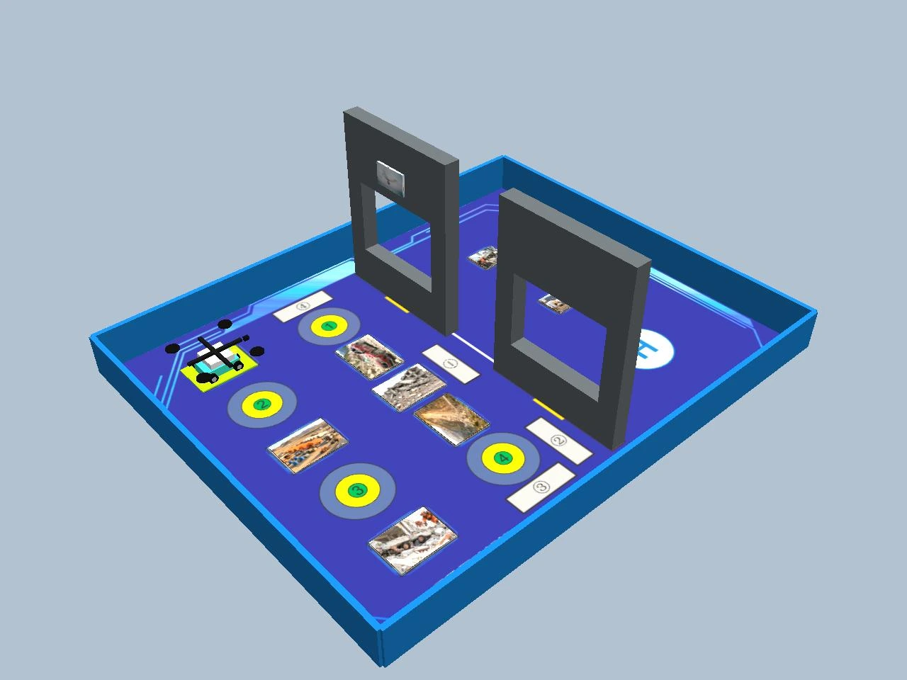
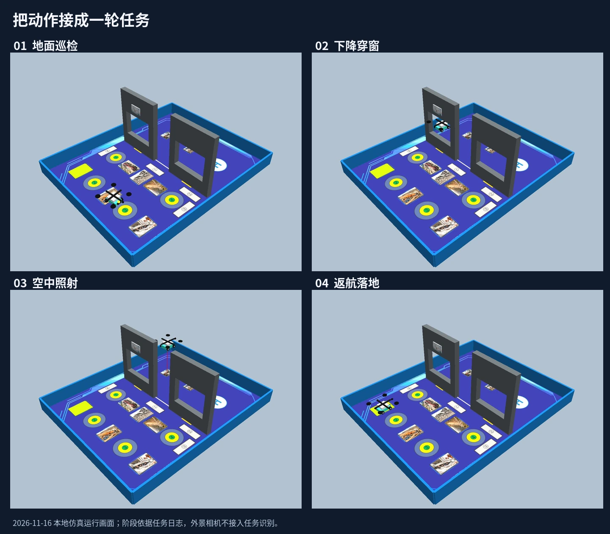
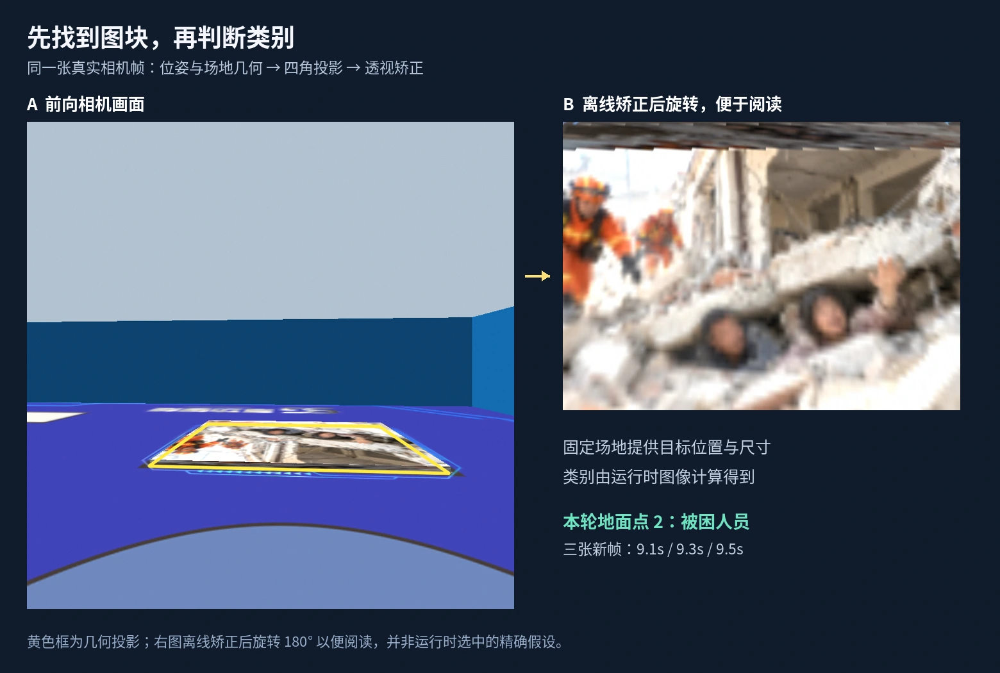

我在这个项目中独立实现了一套城市应急巡检任务系统：机器人能够自主访问地面目标、识别灾情图片，再切换到飞行状态，完成穿窗、空中巡检、定点灯光提示和返航降落。

项目使用 Python 开发，基于 ROS 2 Humble 与 Gazebo Classic 11 运行在 Ubuntu 22.04 上。场地和机器人模型使用赛事提供的仿真资源，我负责感知、运动控制、任务调度以及各模块的集成调试。



## 项目实现了什么

整个系统围绕同一台具备地面移动和飞行能力的仿真机器人展开，主要实现了四项能力：

- **地面自主巡检**：根据输入的目标顺序访问三个地面点，选择观测位置、调整朝向，识别后进入目标区域。
- **灾情图像识别**：识别坍塌废墟、滑坡塌方、被困人员、受损车辆和救援营地；区分窗口上方的救援无人机与飞鸟。
- **空中巡检与动作执行**：自主起飞、识别并穿越窗口，到两个空中目标上方完成识别、对中和定时灯光提示。
- **完整任务调度**：自动衔接地面与飞行阶段，最后返航降落，并对识别超时、传感器异常和动作未完成等情况进行处理。



对应的技术主要分为以下几部分：

| 实现能力           | 涉及技术                               | 在项目中的作用                                 |
| ------------------ | -------------------------------------- | ---------------------------------------------- |
| 感知与控制数据交互 | ROS 2 Topic、Action、QoS、TF2          | 接入相机、雷达与里程计，传递导航目标和运动指令 |
| 地面巡航与精定位   | Nav2、里程计闭环、坐标变换             | 到达观测位、对齐朝向、进入目标区域             |
| 图像定位与分类     | OpenCV、透视变换、多尺度 LBP、LDA、NCC | 提取图块、计算纹理特征并区分类别               |
| 连续观测确认       | 时间戳、独立帧管理、多帧投票           | 减少单帧误判，约束识别结果的使用时机           |
| 飞行与定点动作     | 航点跟踪、比例控制、速度约束           | 起降、穿窗、悬停对中和灯光控制                 |
| 整轮任务执行       | 有限状态机、异步计算、结构化日志       | 调度任务阶段，连接感知结果与动作执行           |

## 地面巡航：从观测位移动到目标区域

地面巡检的过程是“先到观测位，再识别，再入点”。因为前向相机安装位置较低，机器人的距离和朝向会直接影响图像中目标的大小与完整程度，所以观测位置也需要纳入运动安排。

系统结合目标位置、贴图朝向、相机视野与场地边界选择观测位，并考虑移动距离和转身代价。到位后先调整机头，让相机稳定地朝向目标，再启动识别。

地面运动实现了两种控制方式。**Nav2 路径**通过 `NavigateToPose` Action 发送地图坐标系中的目标，接收执行结果，并在需要精调前取消导航、确认控制权已交接。**自有闭环路径**根据里程计计算当前位置与目标的误差，将误差转换到机体坐标系，分别控制前后和侧向速度；麦克纳姆轮底盘可以利用侧向移动调整位置。本次配图运行使用自有闭环路径。

接近目标时，控制器随距离缩小逐步减速，并处理低速运动的死区。进入区域后，系统同时检查位置与朝向，根据机体旋转后的完整包络判断是否到位，停车后再次复核。

平移指令还会经过雷达保护：把扫描点转换到机体坐标系，检查未来一小段运动的扫掠空间。数据缺失、过期、覆盖不足或空间受阻时停止平移。这一部分负责阻止危险运动，绕行路径由导航规划能力提供。

## 视觉识别：从相机画面提取可比较的图块

机器人前向相机看到的地面图片存在明显透视变形。下图左侧是真实相机帧，目标被压缩成很薄的梯形；右侧展示了对该图块进行透视矫正后的效果。



### 几何投影与透视矫正

项目利用已知的目标位置和尺寸，结合机器人位姿、相机内外参，将地面矩形四角投影到图像中。随后通过 OpenCV 的 `getPerspectiveTransform` 和 `warpPerspective`，将四边形展开为统一尺寸的图块。

已知几何信息确定“看哪里”，图片类别由运行时相机画面计算。围绕投影中心和尺度，识别模块还会评估小范围假设，缓解位姿误差对裁剪位置的影响。

### 多尺度 LBP 与 LDA 分类

图块经过灰度化与尺度归一化后，在半径 1、2、3 上分别计算 LBP 纹理直方图，再取均值并进行 L2 归一化，得到 256 维特征。随后使用 LDA 将特征投影到判别空间，通过与各类别中心的距离给出类别排序。

窗口图像识别及部分辅助判断使用 NCC，即归一化互相关模板匹配。地面和空中目标使用对应的分类模型，模型参数保存在 `.npz` 文件中，由 NumPy 与 OpenCV 完成推断。

基础 LBP 的原理和实验见[《从零实现 LBP：基于 OpenCV 的机器人灾害场景识别》](/lbp-disaster-recognition/)。这里在基础特征之外，进一步加入了图块几何处理、多尺度特征与连续观测管理。

### 多帧确认与异步计算

分类输出还需要经过任务层确认。系统按图像时间戳管理新帧，避免同一张图片重复计票；当前配置至少需要三张独立有效新帧，再结合累计票差决定是否接受结果。

后台视觉计算与控制循环分开执行。结果返回时，系统核验任务键、帧龄以及采样后的位姿变化，使图像证据对应到正确的目标。识别超时仍未达到确认门槛时，任务停止依赖该结果的后续动作。

## 飞行控制：起降、穿窗与定点照射

飞行阶段使用航点闭环控制。系统根据当前位姿与目标航点计算水平位置、高度和偏航误差，通过比例控制生成速度，再进行坐标转换与速度约束。控制中还结合仿真运动插件的响应特性，对速度指令进行补偿。

任务层把连续飞行组织成几个具体动作：

- **起飞**：地面返航并完成位置与朝向复核后，爬升到目标高度。
- **穿窗**：接近窗口，面向上方图像完成识别，再沿设定航点下降并穿越开口。
- **空中巡检**：到达目标上方，利用下视相机识别地面图片，调整水平位置并保持稳定。
- **灯光提示**：识别通过且高度、对中条件满足后开灯，结合实际灯光反馈和仿真时间控制照射过程。
- **返航降落**：返回起点上方，降低高度，联合检查水平位置、高度、速度与稳定保持时间，确认落地。

控制器负责向航点收敛，任务状态负责判断动作何时完成。例如，机器人已经移动到空中点附近，还要继续对中并稳定一段时间，才能进入照射阶段。

## 用状态机连接感知与动作

顶层任务采用显式有限状态机，地面点与空中点分别通过循环计数器重复执行。单个地面目标的流程可以概括为：

```text
前往观测位 → 朝向对齐与图像识别 → 进入目标区域 → 停车复核 → 记录完成
```

三个地面目标完成后，状态机转入返航、起飞、窗口穿越和空中巡检；两个空中目标完成后，再进入返程窗口与降落流程。

每个状态分别维护进入动作、持续控制、完成条件和超时处理。这样，识别模块提供的是当前目标的有效结果，运动模块提供的是动作执行状态，状态机据此决定下一步。

在 ROS 2 层，相机、雷达、位姿和动作反馈通过 Topic 接入，Nav2 目标通过 Action 管理，TF2 用于坐标转换；传感器数据和任务事件采用适合各自用途的 QoS。参数集中在 YAML 中管理，状态切换、识别结果、动作目标与异常原因写入 JSONL 日志，支持逐阶段检查运行过程。

这套系统已经在 Gazebo 中完成地面巡检、视觉识别、穿窗飞行、空中灯光提示和返航降落的连续运行。项目把图像处理、机器人运动控制与任务调度连接成了一个自主执行流程，三组配图均来自实际仿真运行。

---

配图采集于 2026 年 11 月 16 日。外景使用独立观察相机保存，识别示意由机器人真实相机帧离线重建。
