不训练任何神经网络。只用直方图、纹理编码、主成分分析和判别投影，配上最朴素的最邻近分类器，在 120 张从未见过的测试人脸上做到 119 张正确。

这篇按实验顺序复盘 6 种特征方案，解释每一步的数字为什么是那个数字。

## 先看全貌：一条流水线

不管多复杂的人脸识别系统，骨架都是四段：**拿到一张图 → 变成一个向量 → 比较向量 → 给出身份**。本文所有"算法之争"，争论的其实只是第二步——怎么把这 10304 个像素变成一串能代表"这个人是谁"的数字。

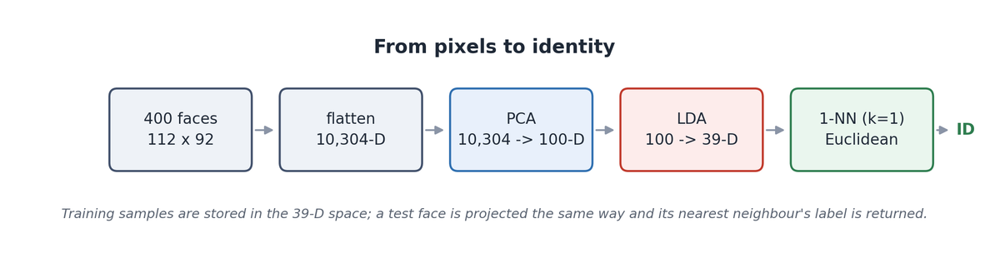

分类器我固定在 1-NN（最近邻），不去调它。这样六组实验之间唯一的变量就是"特征怎么提"，成绩差异才能干净地归因到特征上。

> **数据规模**：400 张人脸、40 个不同的人、10304 维（像素拉平后）、120 张测试图（每人 3 张）。

## 数据集：400 张脸，40 个人

数据来自 Olivetti 研究中心的 ORL / AT&T 人脸库：40 个人，每人 10 张，一共 400 张 92 × 112 的 8 位灰度图。拍摄时有轻微的光照变化、表情变化（睁眼/闭眼、笑/不笑）、戴/不戴眼镜，姿态允许小幅侧转，但全部是正脸、黑底、大致居中、对齐。

先看一眼数据长什么样。下面是 1 号人物的完整 10 张照片——同一张脸，十种不同的拍摄状态：

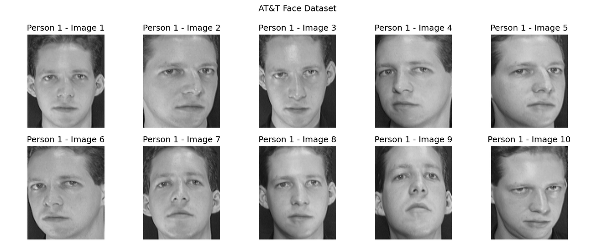

读取就是老老实实两层循环：40 个目录 × 每个目录 10 个 `.pgm` 文件，用 `cv2.imread(..., cv2.IMREAD_GRAYSCALE)` 读成二维数组，400 张堆起来是 `(400, 112, 92)`，然后 `reshape` 成 `(400, 10304)`：

```python
images, labels = [], []
for person_id in range(1, 41):
    for image_id in range(1, 11):
        path = DATASET_DIR / f"s{person_id}" / f"{image_id}.pgm"
        images.append(cv2.imread(str(path), cv2.IMREAD_GRAYSCALE))
        labels.append(person_id)

images = np.array(images)                       # (400, 112, 92)
X = images.reshape(len(images), -1)             # (400, 10304) —— 112 × 92
y = np.array(labels)
```

划分 30% 做测试集，并且按人分层（`stratify=y`）：280 张训练、120 张测试，每个人正好 3 张测试图。固定 `random_state=42` 之后，全员六组实验看到的完全是相同的 120 张测试图——这是让对比成立的前提。

> **注意**：120 张测试集意味着每张图价值 0.83 个百分点。两个方案差 1 张图（比如 98.33% 和 99.17%）在统计上说明不了任何问题。本文提到的所有"提升了多少"，都要按这个刻度去读。

## 基线：像素拉平就是特征

第一个方案故意做到最笨：不提取任何特征，把 10304 个像素值除以 255，直接当坐标，用欧氏距离找最近的训练样本。

```python
X = images.reshape(len(images), -1).astype(np.float32) / 255.0

X_train, X_test, y_train, y_test = train_test_split(
    X, y, test_size=0.3, random_state=42, stratify=y
)

model = KNeighborsClassifier(n_neighbors=1, metric="euclidean")
model.fit(X_train, y_train)
y_pred = model.predict(X_test)      # 95.00% —— 120 张里错 6 张
```

95% 这个数字第一次看有点吓人：一个连"人脸"概念都没有的分类器，凭什么这么准？答案不在算法里，在数据里。ORL 的图已经被裁剪、对齐、正脸、黑底、单人，同一个人不同照片之间的像素差，本来就小于不同人之间的像素差。**不是方法强，是数据干净。**

看看它错在哪 6 张上：

| 测试序号 | 真实人物 | 是此人第几张 | 被判成 |
|:------:|:------:|:------:|:------:|
| 030 | 10 | 9 | 23 |
| 044 | 05 | 10 | 18 |
| 050 | 28 | 8 | 37 |
| 080 | 32 | 7 | 02 |
| 084 | 40 | 10 | 05 |
| 103 | 10 | 10 | 38 |

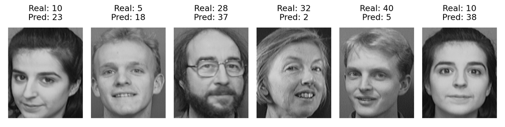

这张图里藏着两条后面会反复出现的线索：

**第一，错误不是随机的。** 仔细看，10 号被认成 23 和 38，5 号被认成 18，40 号被认成 5，28 号被认成 37——这些"混淆对"在后面的 PCA、LDA 实验里几乎原样复现。说明这几对人的照片在像素空间里就是邻居，不是偶然。

**第二，出错的往往是"第 10 张"。** 6 个错误里有 3 个是这个人编号 10 的照片（5 号、40 号、10 号），而 ORL 的第 10 张通常是较晚一次拍摄，光照和姿态偏离最大。

## LBP：让特征忘记光照

像素值有一个天生的毛病：它记录的是**绝对亮度**。同一张脸，灯亮一点，所有像素加 20，欧氏距离立刻就变了，但"这是同一个人"这件事没变。

LBP（局部二值模式）的想法很朴素：别记绝对亮度，只记"邻居比我亮还是比我暗"。取一个 3 × 3 的窗口，拿中心像素当阈值，周围 8 个邻居逐个比较，比中心亮记 1，否则记 0。从左上角开始顺时针读，得到 8 个比特，就是一个 0 ~ 255 的整数。

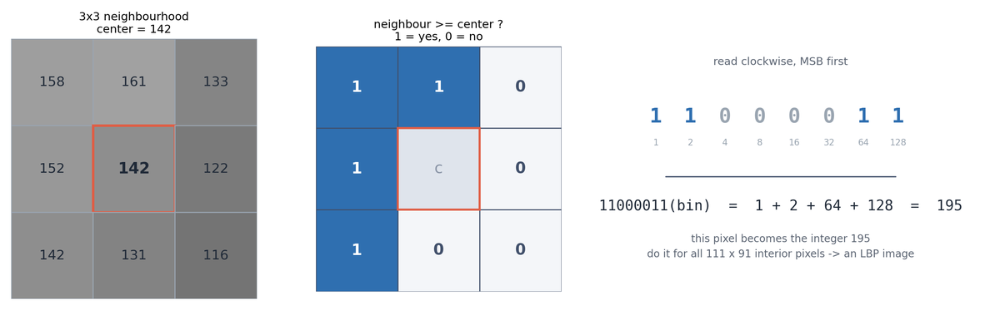

实现起来就是一个双重循环，对 112 × 92 的图跳过最外圈，内部 111 × 91 个像素各自和 8 个邻居比较：

```python
def basic_lbp(image):
    height, width = image.shape
    lbp = np.zeros((height, width), dtype=np.uint8)

    # 8 个邻居，从左上角开始顺时针
    neighbors = [(-1, -1), (-1, 0), (-1, 1),
                 (0, 1), (1, 1), (1, 0), (1, -1), (0, -1)]

    for y_ in range(1, height - 1):
        for x_ in range(1, width - 1):
            center = int(image[y_, x_])
            code = 0
            for bit, (dy, dx) in enumerate(neighbors):
                if int(image[y_ + dy, x_ + dx]) >= center:
                    code |= (1 << bit)
            lbp[y_, x_] = code
    return lbp
```

处理完整张脸，得到的 LBP 图长这样——它已经不像人脸了，但你能清楚地看到眉毛、眼眶、鼻翼、嘴唇的轮廓，因为这些地方灰度变化最剧烈，LBP 值最丰富；而额头、脸颊、背景这些平坦区域，邻居全都比中心亮或全都比中心暗，LBP 值只取 0 或 255，整片糊成黑或白。

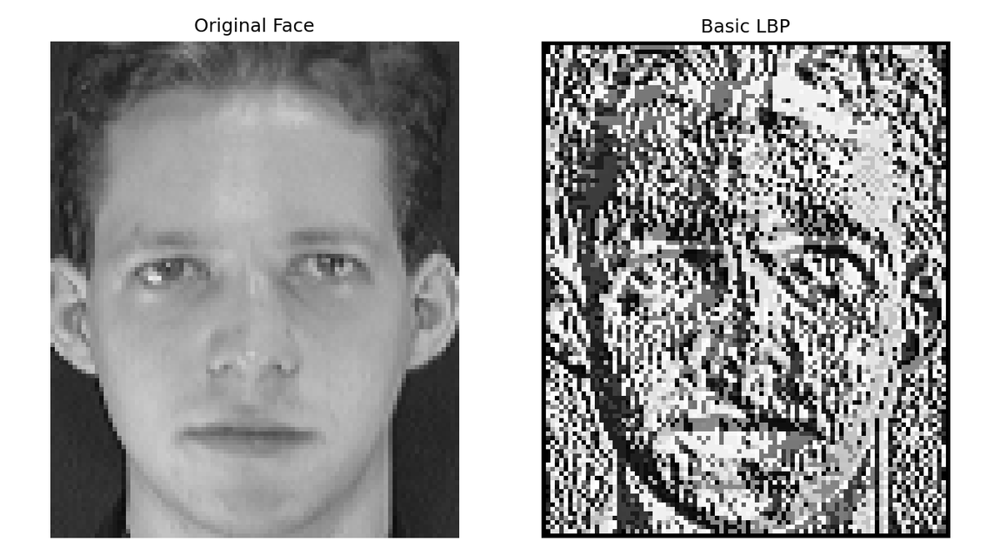

接下来要把这张 LBP 图变成一个向量。最直接的做法是统计直方图：数一数 0 ~ 255 这 256 个 LBP 值各出现了多少次，再除以总像素数做归一化，得到 256 维特征。

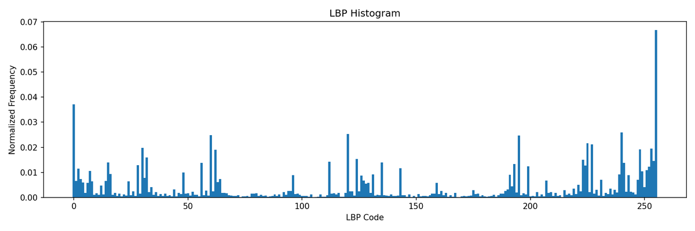

这张图和任何人脸的直方图都长得很像——问题就在这里。

> **直觉结果 #1**：256 维 LBP 直方图 + 1-NN 的准确率是 90.00%，比 10304 维原始像素的 95.00% 还低 5 个百分点。

为什么会这样？直方图是**无序**的。111 × 91 个 LBP 值被一锅倒进 256 个桶里，每个桶只记得"出现了多少次"，完全不记得"出现在哪"。于是眼睛的纹理和脸颊的纹理被平等对待，一张脸的"布局"被彻底抹掉了。

而人脸识别的关键信息，恰恰就是布局：眼睛在中间偏上、左右各一只，鼻子在正中间，嘴在下方。LBP 直方图保留了光照的鲁棒性，付出的代价是丢掉了空间结构。在 ORL 这种光照变化本来就很温和的数据集上，鲁棒性的收益抵不过空间信息的损失，所以成绩反而变差。

## LBPH：把脸切成 16 块

上一步的漏洞很明显：既然丢的是空间信息，那就把空间信息加回来。做法是把脸切成 4 × 4 = 16 个格子，每个格子单独统计一个 256 维直方图，再把 16 个直方图首尾相接，得到一个 16 × 256 = 4096 维的特征。这就是 LBPH（LBP Histograms）。

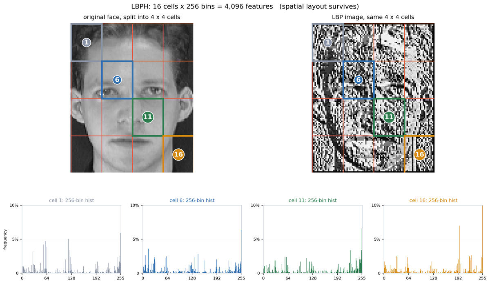

```python
def lbp_histogram_grid(image, grid_x=4, grid_y=4):
    lbp = basic_lbp(image)[1:-1, 1:-1]      # 去掉没算过的边界
    h, w = lbp.shape
    features = []

    for row in range(grid_y):
        for col in range(grid_x):
            y1, y2 = row * h // grid_y, (row + 1) * h // grid_y
            x1, x2 = col * w // grid_x, (col + 1) * w // grid_x

            hist = cv2.calcHist(
                [lbp[y1:y2, x1:x2]], [0], None, [256], [0, 256]
            ).flatten()

            features.extend(hist / hist.sum())      # 每格单独归一化
    return np.array(features, dtype=np.float32)     # 4096 维
```

结果：**97.50%**，120 张里错 3 张。比全局直方图高了 7.5 个百分点，也比原始像素高 2.5 个百分点。仅仅是把"统计全局"换成"分块统计"，就同时吃到了 LBP 的光照鲁棒性和空间布局。

代价是维度从 256 涨到 4096，而且 1-NN 要在 4096 维里算距离。它仍然是手工设计的纹理特征：解释性很好，但天花板也明显——继续切得更细（8 × 8）会带来维度爆炸和样本稀疏，收益迅速递减。

## PCA：特征脸

10304 维听起来很大，但绝大部分维度是冗余的：相邻像素几乎线性相关，而且整幅图的角落是纯黑的背景，那些像素永远是 0。换句话说，**真正在变化的方向**可能只有几十个。

PCA 就是去找这些方向：在 10304 维空间里找一组正交轴，让所有训练人脸投影上去之后**方差最大**。第一个轴方差最大，第二个轴在与第一个正交的前提下方差最大，依此类推。

有意思的是，当你把每个主成分还原成 112 × 92 的图像时，它们看起来也像脸。这就是"特征脸"（eigenface）这个名字的来源：

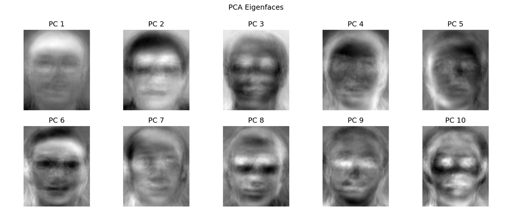

每张人脸都可以写成"平均脸 + 若干特征脸的加权和"。用多少个主成分，就等于保留多少细节。下面这张图把同一张测试脸用 5、10、30、50、100 个主成分分别重建了一次：

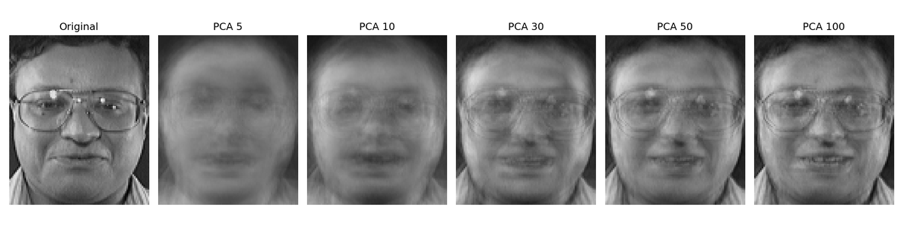

取前 50 个主成分做 1-NN，准确率 95.83%（错 5 张），这 50 维覆盖了训练集 83.05% 的方差。维度从 10304 降到 50，准确率还比原始像素高了 0.83 个百分点——说明砍掉的那部分确实是噪声。

### 方差大 ≠ 判别力强

那是不是主成分越多越好？把主成分数量从 1 扫到 200，同时记录累计方差和 1-NN 准确率：

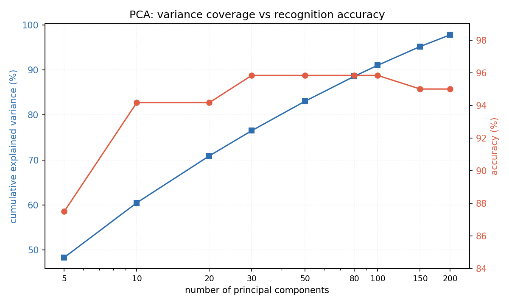

| n | 累计解释方差 | 1-NN 准确率 | 说明 |
|:------:|:------:|:------:|:------|
| 1 | 18.01% | 9.17% | 几乎是瞎猜 |
| 2 | 30.97% | 40.00% | 还是一团糟 |
| 5 | 48.33% | 87.50% | 轮廓出现 |
| 10 | 60.48% | 94.17% | 接近原图 |
| 20 | 70.90% | 94.17% | |
| 30 | 76.50% | 95.83% | 进入平台期 |
| 50 | 83.05% | 95.83% | |
| 100 | 91.02% | 95.83% | |
| 150 | 95.19% | 95.00% | 方差涨，反而差 |
| 200 | 97.78% | 95.00% | |

这张表捅穿了 PCA 的一个本质：**它优化的是"重建"，不是"区分"**。n = 1 时它保住了 18% 的方差——那是全脸最亮最暗的对比，几乎全来自光照，对认人毫无用处。而靠后的主成分方差很小，可正好在描述"这个人和别人不一样"的那一点点细节。PCA 不知道谁是第几号人，它只会保留"变化大"的方向，而"变化大"经常等于"光照"。

> **要点**：PCA 把 10304 维压到 50 维，准确率 95.83%，只比原始像素好一点点。它解决的是"维度太高"，没有解决"哪些维度跟身份有关"。要让特征真正学会区分人，得把标签信息用进去——这就是下一节的 LDA。

## LDA：用标签换判别力

LDA（线性判别分析）的目标函数里直接写着答案：找一组投影方向，使得**同类样本尽量挤在一起（类内散度小），不同类尽量分开（类间散度大）**。它是在有监督地"压掉与身份无关的变化"。

把 400 张脸分别投影到 PCA 和 LDA 的二维平面上，差别一眼就能看出来：

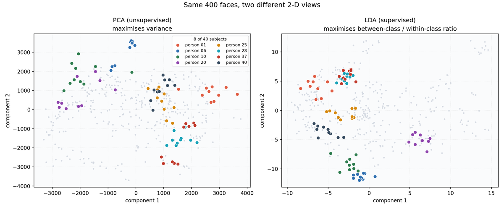

```python
lda = LinearDiscriminantAnalysis(n_components=39, solver="svd")
X_train_lda = lda.fit_transform(X_train, y_train)
X_test_lda = lda.transform(X_test)
```

为什么是 39？因为 LDA 最多只能给出 `C - 1` 个判别方向，C 是类别数。这里有 40 个人，所以上限是 39 维——想多要也没有。

结果 96.67%（错 4 张），比 PCA(50) 高 0.84 个百分点，而且只用了 39 维。方向是对的，但还没到最好。问题出在计算过程里：

> **踩坑**：直接在 10304 维原始像素上做 LDA 是病态的。类内散度矩阵是 10304 × 10304，而训练样本只有 280 个——矩阵严重奇异，绝大多数特征值为 0，数值上几乎不可逆。scikit-learn 的 `svd` 求解器用伪逆把它救了回来，但这已经不是 LDA 想表达的那个东西了。

## Fisherface：两步降维

既然 LDA 在 10304 维上会因为"样本太少、维度太高"而崩，那就先降维再 LDA。这正是 Belhumeur 等人在 1997 年提出的 Fisherface 做法：

1. **先 PCA**：把 10304 维压到 100 维。这一步同时做两件事——去掉噪声和冗余，并且让 100 × 100 的类内散度矩阵重新变得可逆。
2. **再 LDA**：在这 100 维里找 39 个判别方向，把类内差异压到最小、类间差异拉到最大。
3. **最后 1-NN**：在 39 维空间里找最近的训练样本，把它的标签当答案。

```python
# 第一步：PCA 降维（只在训练集上 fit）
pca = PCA(n_components=100, svd_solver="full")
X_train_pca = pca.fit_transform(X_train)
X_test_pca = pca.transform(X_test)

# 第二步：在 100 维上做 LDA
lda = LinearDiscriminantAnalysis(n_components=39, solver="svd")
X_train_lda = lda.fit_transform(X_train_pca, y_train)
X_test_lda = lda.transform(X_test_pca)

# 第三步：1-NN
model = KNeighborsClassifier(n_neighbors=1, metric="euclidean")
model.fit(X_train_lda, y_train)     # 99.17% —— 120 张里只错 1 张
```

同一份数据、同一个分类器、同样 39 维输出，只是把降维拆成"先 PCA 再 LDA"两步，错误数就从 4 降到 1。这不是调参调出来的，而是修好了 LDA 的适用条件。

### K 取多少？

顺手把 KNN 的 K 扫了一遍：

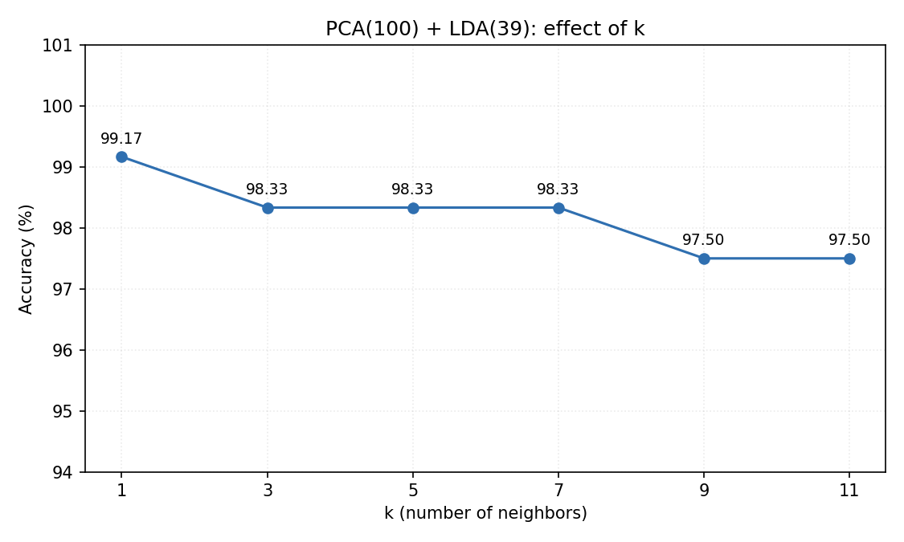

为什么 K 变大反而变差？因为 LDA 已经把每个人的样本压得很紧，最近的邻居几乎全是同类。这时候扩大邻域，反而容易把边界附近其他类的样本拉进投票里。换句话说：**特征好到一定程度，复杂分类器就没有用武之地了。**

## 错误分析：他们被认成了谁

99.17% 看着很好，但剩下那 1 张错在哪，比这个数字更有信息量。先把 PCA(50) 和 LDA(39) 的错误放到一起看——两种方法一共错了 7 张（有重叠），下面每一行三张图：被测试的那张脸、真实身份的训照、被误认成的那个人的训练照。

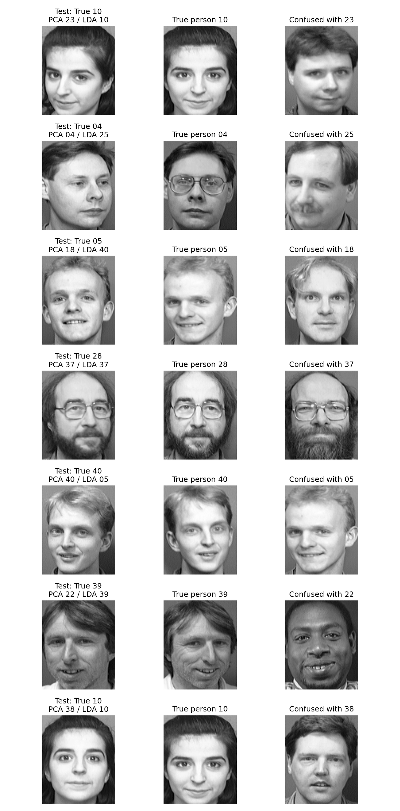

逐条读下来，能挖出三件事。

**第一，错误集中在固定的几对人身上。** PCA 错 5 张、LDA 错 4 张、两种都错 2 张，总共只涉及 7 张图，而混淆对象反复是 10↔23、10↔38、05↔18、05↔40、28↔37、04↔25、39↔22。这些数字和第三节原始像素的 6 个错误大面积重叠。说明这几对人的照片在特征空间里天生就靠得很近，换特征只是换了个"错法"，没有改变"难"这个事实。

**第二，05 和 40 互相认错。** LDA 把 5 号认成 40 号，又把 40 号认成 5 号。这种对称的混淆最说明问题：两个人的特征向量互为最近的邻居，光靠换降维方法是拆不开的。

**第三，7 张里有 5 张是"这个人的第 10 张照片"。** ORL 的第 10 张往往是另一次拍摄，光照角度、头部姿态、表情都跟前面九张差别最大。模型见过的这个人的 7 张训练图，没有一张跟它像。

### 最后剩下的那 1 张

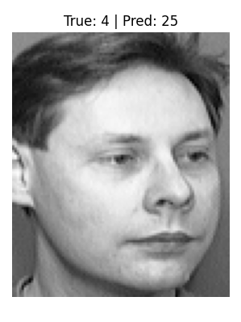

看这张图就明白为什么难：它是一张侧脸，戴着眼镜，左半边脸被强光照亮。而 4 号人物的其他照片是正脸、光线均匀。特征里没有任何显式的姿态建模，这个侧脸在 39 维空间里恰好落到了 25 号的附近，仅此而已。

这暴露出这类方法的共同瓶颈：**它们假设"同一张脸的不同照片，在特征空间里是同一团"**。当姿态变化足够大，这个假设就破了——而打破它的方式不是换一个更好的线性投影，而是让特征本身具备姿态不变性（或者干脆用数据对齐掉姿态）。

## 六种方案横向对比

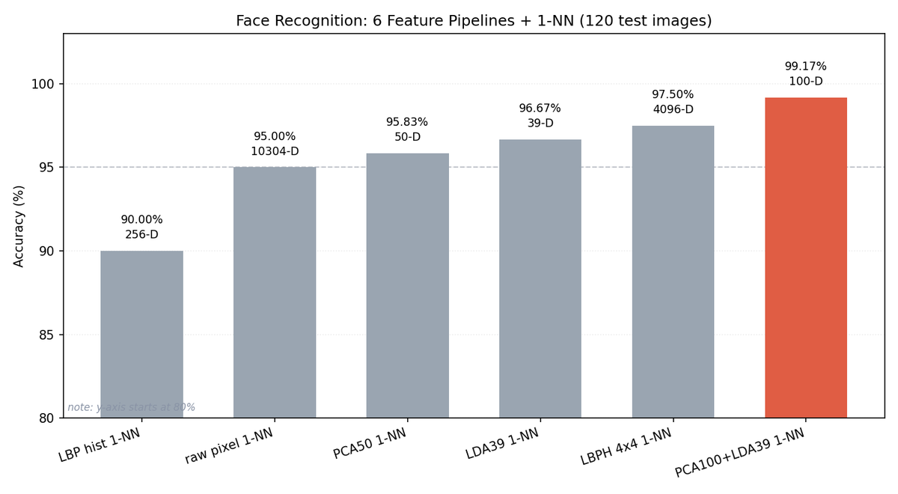

| 方案 | 维度 | 正确 | 准确率 |
|:-----|------:|----:|------:|
| LBP 全局直方图 | 256 | 108/120 | 90.00% |
| 原始像素 | 10,304 | 114/120 | 95.00% |
| PCA(50) | 50 | 115/120 | 95.83% |
| LDA(39) | 39 | 116/120 | 96.67% |
| LBPH 4×4 | 4,096 | 117/120 | 97.50% |
| PCA+LDA | 39 | 119/120 | 99.17% |

下表六行都是同一个 1-NN 分类器，只是喂进去的特征不同。这张表的读法比数字本身重要。准确率跨度 9.17 个百分点，而分类器始终是那个 1-NN——差距全部来自特征。维度也不是越高越好：10304 维原始像素和 4096 维手工纹理都输给了 39 维的判别投影。决定成绩的是**这 39 维里，有多少是在描述身份**。

## 工程细节与踩过的坑

数字是跑出来的，但真正让数字可信的是下面这些细节。

**1. 数据划分必须钉死。** 六组实验全部使用 `train_test_split(..., test_size=0.3, random_state=42, stratify=y)`。任何一处不一致，准确率就不可比了——而 120 张的测试集，换一个随机种子动 2 ~ 3 个百分点是常事。

**2. 降维只能在训练集上 fit。** PCA 和 LDA 都要 `fit` 在 `X_train` 上，然后 `transform` 测试集。如果图省事拿全部 400 张去 fit，测试集的方差信息就混进了特征里，准确率会虚高，而且这种"提升"换到真实场景立刻消失。

```python
# 对：测试集只 transform，不参与 fit
pca.fit(X_train)
X_train_pca = pca.transform(X_train)
X_test_pca = pca.transform(X_test)

# 错：信息泄露，测试集的分布被提前看到了
pca.fit(X)
X_train_pca = pca.transform(X_train)
```

**3. 特征的尺度要一致。** 欧氏距离对量纲敏感。原始像素除以 255 压到 0 ~ 1；LBPH 的每个格子单独归一化成频率。如果某组特征的值域比别的大一个数量级，距离就会被它单方面支配。

**4. 纯 Python 的 LBP 很慢。** 111 × 91 个像素、每个像素 8 次比较，400 张图一共约 3200 万次比较，实测 5.1 秒。做实验够用，但生产环境应该用 `skimage.feature.local_binary_pattern` 或者向量化的 8 次 `np.roll`。

**5. 120 张测试集，不要过度解读。** 每张 0.83 个百分点。99.17% 与 98.33% 之间只差 1 张图，属于随机波动范围。要得出更可靠的结论，应该做 5 折交叉验证，或者换 10 个随机种子取平均。本文所有"更好/更差"的判断，都只针对差距达到 3 张图以上的情况。

**6. 边界像素别忘掉。** LBP 需要 3 × 3 的完整邻域，所以图像最外圈那一圈像素是算不出来的（初始化为 0）。统计直方图时要用 `lbp[1:-1, 1:-1]` 把这一圈剔除，否则每张图都会凭空多出一大片 0 值，污染整维特征。

## 结论与下一步

从 90.00% 到 99.17%，六种方案的推进路线是清晰的，而且每一步都有可解释的原因：

1. 原始像素 95% 说明数据本身很干净，同一个人不同照片的像素距离天然就小。
2. LBP 全局直方图到 90% 说明"去掉光照"这件事如果代价是"丢掉空间结构"，在人脸识别上得不偿失。
3. LBPH 回到 97.5% 说明空间结构可以用分块统计找回来，代价是维度涨到 4096。
4. PCA 95.83% 说明降维能去掉噪声，但"方差大"不等于"能区分人"。
5. LDA 96.67% 说明引入标签立刻有用，但它在高维小样本下数值上不可靠。
6. PCA + LDA 99.17% 说明正确的做法不是"用更强的模型"，而是让模型满足它自己的假设：先让类内散度矩阵可逆，LDA 才能正常工作。

> **三个可以带走的结论**
>
> ① 特征比分类器重要。分类器一动没动，六组实验的准确率跨度 9 个百分点。
>
> ② 好的降维不是压得越狠越好，而是压掉与任务无关的变化。PCA 压的是方差，LDA 压的是类内差异——后者直接对准了"认人"这个目标。
>
> ③ 经典方法在干净的小数据上强得惊人。400 张训练图、没有任何神经网络，119/120 正确。

### 这套方法的边界在哪里

ORL 之所以能让手工特征发挥到 99%，是因为它满足一长串理想条件：正脸、居中、黑底、单人、对齐、光照温和、每人 10 张。这些条件里任何一个被破坏，成绩就会掉。换到 LFW 这类自然场景数据集，同样这套 LBPH / Fisherface 会明显吃力——那不是实现的问题，是特征里没有对姿态、遮挡、尺度做建模。

如果要继续往下做，我会按这个顺序试：

1. **人脸对齐**：先用眼睛位置做仿射变换，把所有脸对齐到统一姿态，再提特征。这一步通常比换特征带来的收益更大。
2. **多尺度 LBP**：把 3 × 3 邻域换成半径 1、2、3 的多尺度版本，或者用 uniform LBP（把 256 种模式合并成 59 种），降低维度、提升鲁棒性。
3. **网格搜索降维参数**：PCA 的 100 维和 LDA 的 39 维都是我按经验定的，应该把 PCA 维数、LDA 维数和 K 这三个参数一起扫一遍，并用交叉验证而不是单次划分来选。
4. **做事后校准**：现在 1-NN 只输出"最近的是谁"，不输出"有多确定"。加上最近邻距离阈值，就能把"不像任何已知人物"的输入识别成"未知"，这在实际系统里是必须的。

最后一句话总结这次实验：在 10304 维的像素里，真正描述"你是谁"的那部分可能只有几十维；所有方法的差别，就在于它有没有本事把那几十维找出来。

## 复现方式

仓库里的脚本按顺序跑一遍即可，文中所有数字和图都来自这些脚本的输出：

```bash
# 环境
python -m venv .venv
. .venv/bin/activate
pip install opencv-python numpy scikit-learn matplotlib

# 依次运行各个案例
python src/case_01_dataset.py              # 读数据 + 展示 1 号人物
python src/case_02_baseline.py             # 原始像素 + 1-NN
python src/case_03_lbp.py                  # LBP 算子与直方图
python src/case_03_lbp_knn.py              # LBP 全局直方图 + 1-NN
python src/case_04_lbph_knn.py             # LBPH 4×4 + 1-NN
python src/case_05_pca_knn.py              # 特征脸 + 1-NN
python src/case_05_pca_reconstruction.py   # 主成分重建对比
python src/case_06_lda_knn.py              # LDA + 1-NN
python src/case_07_compare_pca_lda.py      # PCA vs LDA 错误分析
python src/case_08_pca_lda_knn.py          # PCA + LDA + 不同 K
python src/case_09_algorithm_comparison.py # 六方案总对比
```

数据集版权归 Olivetti Research Laboratory 所有。引用请注明：F. Samaria and A. Harter, *Parameterisation of a stochastic model for human face identification*, 2nd IEEE Workshop on Applications of Computer Vision, December 1994.

文中所有准确率的测试集均为 120 张，划分固定为 `random_state=42`。
