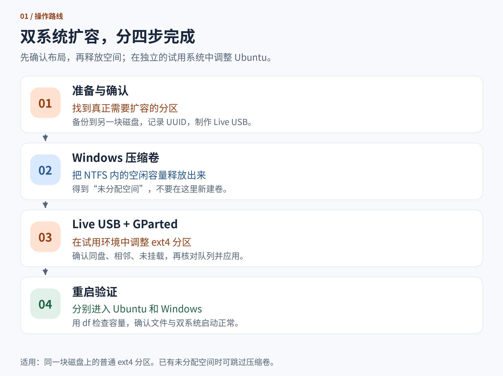
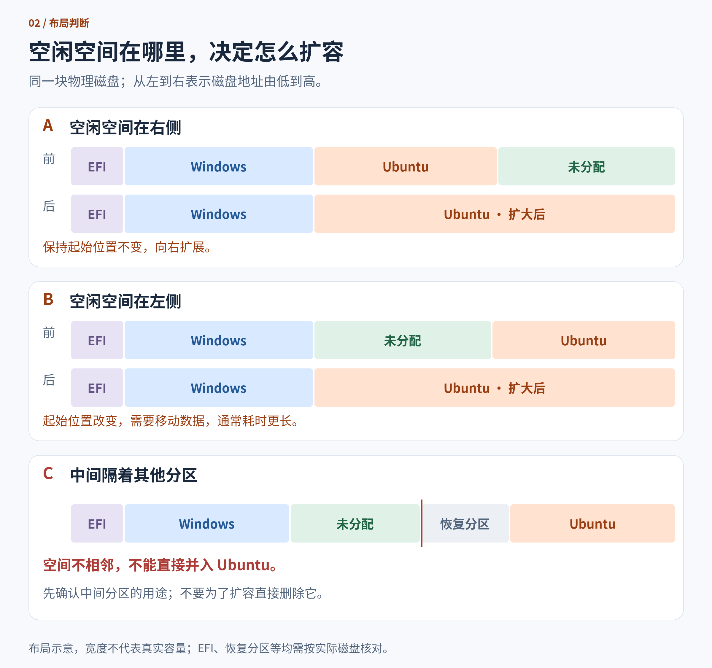
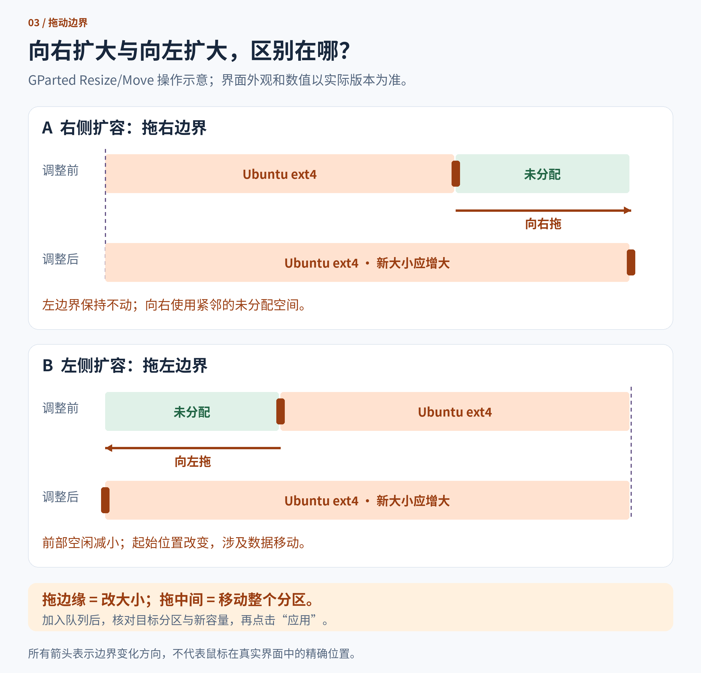

装双系统时给 Ubuntu 分了几十 GB，用了一段时间，软件、开发环境和项目文件越装越多，根分区开始告急。Windows 那边明明还有空间，能不能分一些给 Ubuntu？

可以，但要先看磁盘上的分区排列。**Windows 里的“可用空间”，需要先变成“未分配空间”，再让 Ubuntu 分区把它接过来。**

这篇以 **Windows + Ubuntu 双系统、Ubuntu 使用普通 ext4 分区**为例，通过 Windows 磁盘管理和 Live USB 中的 GParted 完成扩容。文中的布局都是示意，不代表你的实际磁盘。



## 一、先确认：到底哪个分区满了

在 Ubuntu 终端中执行：

```bash
df -hT / /home
lsblk -o NAME,SIZE,FSTYPE,MOUNTPOINTS
findmnt -no SOURCE,FSTYPE /
```

这几条命令分别用来查看空间使用情况、磁盘结构，以及根目录 `/` 对应的设备和文件系统。

- `/` 接近满了：通常要扩大根分区。
- `/home` 是独立分区且快满了：应扩大 `/home` 所在的分区。
- `/` 和 `/home` 显示同一个文件系统：它们共用空间，扩大这个分区即可。

例如，下面表示根目录位于 NVMe 硬盘的第 5 个分区：

```text
/dev/nvme0n1p5 ext4
```

**不要照抄这个设备名。** 你的根分区可能是 `/dev/sda3`，也可能在另一块硬盘上。后面进入 Live USB 后，设备名也要重新核对。

如果看到 `/dev/mapper/...`、`crypto_LUKS`、`LVM2_member`，或者文件系统是 Btrfs，就不能直接照搬本文的普通 ext4 流程。加密映射、逻辑卷或其他文件系统需要按实际结构处理。

## 二、理解扩容的关键：空间要在同一块磁盘上，而且紧挨着

Windows 的 D 盘还有 100 GB 可用，不代表磁盘上已经有 100 GB 未分配空间。前者仍属于 D 盘，需要先压缩卷，才能把一部分空间释放到分区外。

对普通分区来说，扩容还要求这块未分配空间与目标分区相邻，并且位于**同一块物理磁盘**。如果 Windows 在一块 SSD、Ubuntu 在另一块 SSD，压缩 Windows 分区不会给 Ubuntu 那块盘增加容量。

下面把三种常见布局放在一起比较，从左到右表示磁盘地址由低到高。各色块只表示分区位置，宽度不代表真实容量。



### 情况 A：未分配空间在 Ubuntu 右边

这通常最直接：保持 Ubuntu 分区左边界不动，把右边界向右扩展。

### 情况 B：未分配空间在 Ubuntu 左边

这是压缩前面的 Windows 分区后经常出现的布局。

看起来只是把 Ubuntu 向左拉宽，但分区的起始位置变了。**GParted 需要移动文件系统中的数据，再完成扩容，耗时可能明显增加。**

### 情况 C：中间还隔着一个分区

此时空闲空间并没有紧挨 Ubuntu，不能直接并入。必须先处理夹在中间的分区，才可能让空间相邻。

不要因为分区很小，就把 EFI、MSR 或 Windows 恢复分区当成“没用的东西”删除。它们可能承担启动、系统管理或恢复功能。如果需要移动这些分区，应先确认用途和恢复方案；本文不提供通用的删除或移动步骤。

## 三、操作前准备

调整分区会修改磁盘结构，移动分区还会搬运已有数据。先完成以下准备，再点“应用”：

1. **备份重要文件到另一块物理磁盘或可靠的远端存储。** 同一块磁盘上的另一个分区不能代替独立备份。
2. **记录当前布局。** 保存 Windows 磁盘管理、Ubuntu `lsblk` 的输出，以及根分区的 UUID。UUID 可以用 `lsblk -f` 查看。
3. **准备 Ubuntu Live USB。** 使用 Ubuntu 安装镜像制作启动 U 盘，启动后进入“试用 Ubuntu / Try Ubuntu”。制作 U 盘会清空所选 U 盘，注意目标设备。
4. **接好电源，留出足够时间。** 移动分区可能耗时很长，期间不能关机、休眠或拔掉磁盘。
5. **检查 Windows 加密状态。** 如果启用了 BitLocker 或设备加密，提前保存恢复密钥；涉及启动相关变更时，按 Windows 指引暂停保护，并在验证后恢复。

还要确认硬盘没有明显的读写错误。如果已经出现 I/O 错误或健康告警，应先处理数据备份和硬盘故障。

## 四、在 Windows 中释放未分配空间

如果目标磁盘上已经有足够的未分配空间，可以跳过压缩卷这一步。

### 1. 打开磁盘管理

进入 Windows，按 `Win + X`，选择“磁盘管理”。

找到和 Ubuntu 位于同一块物理磁盘上的 NTFS 卷，右键选择“压缩卷”。输入要释放的容量，确认后执行。

例如，要腾出约 50 GiB，可以在以 MB 为单位的输入框中填入约 `51200`。不同工具的容量显示和取整可能略有差异。

完成后应看到黑色区域，标注为**“未分配”**。不要在这里新建简单卷，也不要格式化成 NTFS；这块空间要留给 Ubuntu。

> Windows 磁盘管理通常不能识别 ext4 文件系统。对 Ubuntu 分区弹出的初始化、格式化等提示，不要确认。

### 2. 如果可压缩容量比预期小

NTFS 卷末尾可能存在不可移动文件，因此“卷内剩余空间很多”和“能压缩很多”并不等价。

先检查 Windows 文件系统状态，并根据 Windows 的提示处理。不要为了腾空间直接删除恢复分区，也不要在不理解用途时关闭系统功能。如果当前布局需要较多分区搬移，也可以考虑把项目、数据集等迁移到另一块磁盘，减少根分区的占用。

### 3. 完整关闭 Windows

关闭 Windows 的“快速启动”，确保没有处于休眠状态，再完整关机。快速启动使用的混合关机可能让 NTFS 保留休眠状态，影响后续对相关分区的操作。

如果 GParted 提示 NTFS 处于休眠、未正常卸载或存在错误，应回到 Windows 处理，不要强行绕过检查。

## 五、从 Live USB 启动，用 GParted 扩容

### 1. 进入试用环境

从启动菜单选择 Ubuntu U 盘，进入“试用 Ubuntu / Try Ubuntu”，不要选择安装系统。

**根分区正在被 Ubuntu 自己使用时，不能直接按本文流程移动它。** Live USB 提供一个独立运行的系统，让原来的 Ubuntu 分区可以保持未挂载。

打开 GParted。如果试用环境没有预装，可以在联网后运行：

```bash
sudo apt update
sudo apt install gparted
```

这里是在 Live 环境中安装工具，不会重新安装硬盘上的 Ubuntu。

### 2. 选对磁盘，确认分区身份

在 GParted 右上角选择目标磁盘，按容量、型号和分区布局核对。不要选成启动 U 盘或备份硬盘。

再次运行：

```bash
lsblk -f
```

结合之前记录的 UUID、文件系统和容量，确认哪个 ext4 分区是原系统的 `/` 或 `/home`。**Live 环境中的 `/` 属于试用系统，不能用它来判断原系统的根分区。**

如果目标分区已挂载，先在 GParted 中右键选择“卸载 / Unmount”。如需操作的 swap 分区正在使用，应先对该分区执行“关闭交换空间 / Swapoff”。

只读检查也可能发现文件系统错误。如果工具报告异常，先解决异常，再继续扩容。

### 3. 根据空闲空间的位置调整大小

右键目标 ext4 分区，选择“调整大小/移动 / Resize/Move”。



| 未分配空间的位置 | 在窗口中的操作               | 需要注意                     |
| ---------------- | ---------------------------- | ---------------------------- |
| Ubuntu 右边      | 向右拖动右边界，增大分区     | 保持左边界和起始位置不变     |
| Ubuntu 左边      | 向左拖动左边界，纳入前方空间 | 会改变起始位置，涉及数据移动 |
| 与 Ubuntu 不相邻 | 先取消，重新分析布局         | 当前不能直接扩容             |

对于左侧扩容，窗口中的“前部空闲空间 / Free space preceding”会随左边界向左移动而减小，“新大小 / New size”应相应增大。确认右边界仍在预期位置。

**不要只拖动分区中间。** 那通常是在移动整个分区，容量并没有增加。最终要检查“新大小”，确认它确实变大了。

保留工具默认的 MiB 对齐方式，不必为了吃掉极小的对齐空隙而反复调整边界。

### 4. 核对待执行操作，再应用

点击调整窗口中的确认按钮后，GParted 通常只是把操作加入队列，还没有真正写入磁盘。

查看下方的待执行操作列表，确认：

- 操作对象是目标磁盘上的 Ubuntu ext4 分区。
- 新容量符合预期。
- 没有误加删除、格式化或其他分区的修改。
- 如果发生移动，移动方向与之前分析的布局一致。

确认后，点击工具栏的“应用所有操作 / Apply All Operations”。等待所有步骤完成，再关闭窗口。

对于支持的普通 ext4 分区，GParted 会在调整分区时调用相应工具调整文件系统。正常完成后，不需要再机械地补一遍 `resize2fs`。

如果中途失败，保存错误详情和操作日志，先判断哪些步骤已经完成。不要反复点击应用，更不要通过格式化“修复”。

## 六、扩容后检查 Ubuntu 和 Windows

关闭试用系统，按提示移除 U 盘，重新启动硬盘上的 Ubuntu。

进入系统后运行：

```bash
df -hT / /home
lsblk -f
findmnt -no SOURCE,FSTYPE /
```

检查目标挂载点的总容量是否增加，项目文件能否正常读取，常用软件是否能启动。`df` 显示的是文件系统容量，和分区工具显示的原始容量不必完全一致。

随后重启进入 Windows，确认系统和文件正常；如果之前暂停了 BitLocker 保护，完成验证后恢复保护。

保留原有分区并正常调整大小时，UUID 通常不会改变，因此一般不用修改 `/etc/fstab`，也不用为了扩容专门重装 GRUB。

如果扩容后无法启动，先区分是固件启动项、GRUB、UUID 配置还是文件系统错误，再从 Live USB 检查。不要在尚未确认根分区和 EFI 分区时直接照抄引导修复命令。

## 七、把启动 U 盘恢复为普通存储 U 盘

双系统都能正常启动、文件和容量也确认无误后，就可以把 Live USB 恢复成日常存文件的 U 盘。如果还需要排查启动问题，先保留它作为修复工具。

这里的“恢复”是**重建 U 盘的分区和文件系统，不是找回被删除的文件**。下面的操作会清空所选 U 盘，先备份其中需要保留的文件。

制作启动盘时，镜像可能写入了多个分区。因此，只格式化资源管理器里看到的那个盘符，不一定能恢复 U 盘的全部容量。

### 方法 A：在 Windows 中恢复

先从电脑内置硬盘启动 Windows，再插入 U 盘。打开“磁盘管理”，通过容量和插拔前后的变化确认 U 盘，避免把系统硬盘当成目标。

如果允许删除 U 盘上的现有卷，可以删除这些卷，使整只 U 盘变成未分配空间，再右键新建简单卷，使用全部可用容量并格式化。

如果遇到不能删除的启动分区，或容量仍不完整，可以用管理员身份打开终端，运行 DiskPart：

```text
diskpart
list disk
```

根据容量找到 U 盘，然后执行下面两行。把 `<U盘磁盘编号>` 换成实际数字；**这只是占位符，不要照抄，也不要凭经验默认是磁盘 1。**

```text
select disk <U盘磁盘编号>
detail disk
```

再次核对型号、容量和卷信息，确保选中的是准备清空的 U 盘。必要时先退出工具，拔出 U 盘对比磁盘列表，再插回重新识别。

**确认目标无误后**，执行：

```text
clean
create partition primary
format fs=exfat quick
assign
exit
```

`clean` 会清除当前所选磁盘的分区信息。后面的命令会创建一个占用可用空间的分区，快速格式化为 exFAT，并分配盘符。快速格式化不等于安全擦除全部旧数据。

### 方法 B：在 Ubuntu 中恢复

先退出 Live USB，从内置硬盘启动已经安装好的 Ubuntu。**不要在仍由这只 U 盘运行的试用环境中擦除它。**

1. 打开“磁盘 / Disks”应用，在左侧按型号和容量选中 U 盘。
2. 如果 U 盘上的分区已挂载，先点击停止按钮卸载。
3. 在整盘菜单中选择“格式化磁盘 / Format Disk”，重建分区表。普通存储 U 盘若没有特殊要求，可选择兼容性较广的 MBR/DOS 分区表。
4. 在空闲空间上点击加号，新建一个使用全部可用空间的分区。
5. 按用途选择文件系统，完成创建后重新插拔，检查能否正常读写。

菜单名称可能随版本略有不同。关键是**先处理整只 U 盘的分区表，再创建数据分区**，不要只格式化原有的小分区。

| 文件系统 | 适合的用途                              | 需要注意                 |
| -------- | --------------------------------------- | ------------------------ |
| exFAT    | 在现代 Windows 和 Ubuntu 之间交换大文件 | 部分旧设备不支持         |
| FAT32    | 需要兼容较旧的设备                      | 单个文件不能达到 4 GiB   |
| ext4     | 主要在 Linux 中使用                     | Windows 默认不能直接读写 |

最后复制一个测试文件到 U 盘，安全弹出后重新插入，确认文件能打开、总容量符合预期。标称容量与系统显示值存在单位换算差异属于正常现象。

## 八、常见问题

### GParted 的“调整大小/移动”是灰色的

先检查目标分区是否已挂载、相关 swap 是否仍在使用，以及工具是否报告文件系统不受支持或存在错误。涉及根分区移动时，应在 Live USB 环境中操作。

### 压缩 Windows 后，Ubuntu 还是不能扩大

看 GParted 的分区图：未分配空间是否和 Ubuntu 在同一块磁盘？两者之间是否隔着恢复分区、swap 或其他分区？

在传统 MBR 布局中，还可能有扩展分区边界的限制。即使图上靠得很近，也需要确认空闲空间与逻辑分区的容器关系；不要直接套用上面的简单示意图。

### 分区变大了，但 Ubuntu 里的容量没变

先确认查看的是正确的挂载点。扩大根分区不会自动扩大独立的 `/home`。

如果 `lsblk` 显示分区变大，而 `df` 中对应文件系统没有变大，可能是文件系统扩容步骤未完成。先查看 GParted 日志，确认文件系统类型和状态，再决定后续处理。

### 能不能把另一块硬盘的空间直接并入根分区

本文这种普通 ext4 分区不能直接跨磁盘扩展。另一块盘可以单独挂载，用于存放项目、数据集或其他大文件；跨盘逻辑卷属于不同的存储方案。

## 参考资料

- [GParted 官方用户手册](https://gparted.org/display-doc.php?name=help-manual)：分区调整、移动和操作队列的具体说明。
- [Ubuntu 官方下载页面](https://ubuntu.com/download/desktop)：获取用于制作 Live USB 的桌面版镜像。
